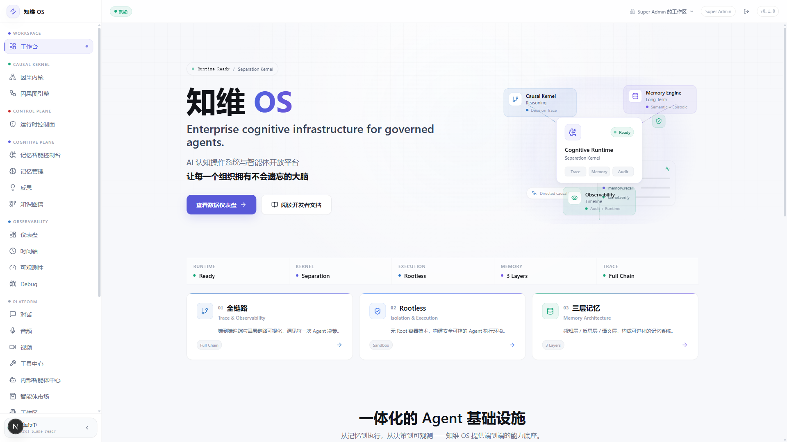

# 知维 OS · Zhiwei OS

知维 OS 是一个带长期记忆的 AI 工作台。你可以检索对话中保存的记忆，在知识图谱中查看它们的关联，或运行「会议纪要转培训」工作流，查看多个 Agent 如何协作。



**后端** · Python / FastAPI　　**前端** · Next.js / React　　**记忆存储** · SQLite / ChromaDB

[后端入口](main.py) · [前端页面](frontend/app) · [架构设计](docs/ARCHITECTURE.md) · [会议纪要转培训演示](docs/STEP20D_DEMO_SCRIPT.md)

<details>
<summary><strong>本地运行 · Windows PowerShell</strong></summary>

准备 Python 3.11、Node.js 20 或 22 和 npm。如果使用 **Code → Download ZIP**，解压后直接在包含 `main.py` 的目录开始第 1 步。

```powershell
git clone https://github.com/wangweilp/-agent.git zhiwei-os
cd zhiwei-os
```

**1. 配置后端。** 首次运行时创建虚拟环境，将配置模板复制为项目根目录的 `.env`。

```powershell
py -3.11 -m venv .venv
.\.venv\Scripts\python.exe -m pip install -r requirements-dev.txt
Copy-Item config/.env.template .env
New-Item -ItemType Directory -Force data | Out-Null
```

在 `.env` 中填写自己的 `DEEPSEEK_API_KEY` 以使用模型对话。默认配置使用 SQLite 保存结构化数据，使用 ChromaDB 保存向量。首次加载默认中文向量模型 `BAAI/bge-small-zh-v1.5` 可能需要联网下载。

**2. 启动 API。** 在项目根目录运行以下命令，然后打开 [API 文档](http://127.0.0.1:8000/docs)。

```powershell
.\.venv\Scripts\python.exe -m uvicorn main:app --host 127.0.0.1 --port 8000
```

**3. 启动工作台。** 在项目根目录打开第二个终端。

```powershell
cd frontend
npm ci
npm run dev
```

打开[本地工作台](http://localhost:3000)，进入[业务场景](http://localhost:3000/agents/scenarios)体验多 Agent 协作。

</details>

<details>
<summary><strong>开发与测试</strong></summary>

后端核心类型位于 `src/core/`，模型与存储适配器位于 `src/adapters/`，HTTP 接口位于 `src/api/`。以下命令验证同步任务的恢复、取消、并发执行与租户隔离。

```powershell
.\.venv\Scripts\python.exe -m pytest -q tests/test_sync/test_p1_lifecycle.py tests/test_sync/test_cross_tenant_isolation.py
```

完整后端测试使用 `python -m pytest`（先激活虚拟环境）。前端测试在 `frontend/` 下运行 `npm test`，类型检查使用 `npm run typecheck`。

[接口路由清单](docs/API_ROUTE_INVENTORY.md) · [Agent 市场](docs/STEP21_MARKETPLACE_DEMO_SCRIPT.md) · [开发者平台](docs/STEP22_OPEN_PLATFORM_DEMO_SCRIPT.md)

历史验收记录见 [Step 24 Runtime Safety Layer](docs/STEP24_RUNTIME_ARCHITECTURE_SUMMARY.md) 和 [Step 25 发布清单](docs/STEP25_RELEASE_CHECKLIST.md)。25-C、25-J、25-K 已完成 ✅。这两个阶段的执行边界为 **external execution blocked · no production sandbox · no third-party code execution**。当前运行时边界见[治理说明](docs/runtime-governance-boundary.md)。

</details>
